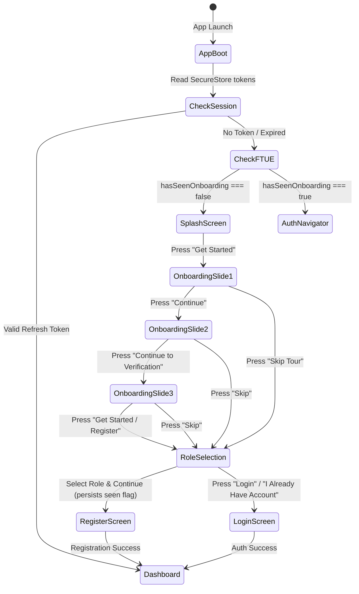

# MASTER PLAN — EcoNexus Onboarding, Splash & Role Selection Experience

This document is mirrored in [`MASTER_PLAN_ONBOARDING.md`](./MASTER_PLAN_ONBOARDING.md).

**Project:** EcoNexus — Smart Waste Collection & Recycling Platform (SE5104)  
**Module:** Onboarding Flow, Splash Screen & Multi-Role Selection Experience  
**Client:** React Native (Expo SDK 57, TypeScript, React Native Web)  
**Reference Design:** Figma UI Screenflow (`media_1794228737869_b4a30542.jpg`)  
**Target File in Repository:** `mobile/src/screens/auth/` & `mobile/src/navigation/`  
**Date:** November 2026  

---

## 1. Executive Summary & Objectives

This master plan specifies the end-to-end design and implementation of the **first-time user experience (FTUE)** for EcoNexus, spanning five high-fidelity screens depicted in the Figma system design:

```
┌──────────────────────────────────────────────────────────────────────────────────┐
│                                 APP LAUNCH                                       │
│                                      │                                           │
│                                      ▼                                           │
│                             [ 1. Splash Screen ]                                 │
│                     (Branding, Version, System Audit)                            │
│                                      │                                           │
│                        First Launch  │  Returning User                           │
│                     ┌────────────────┴────────────────┐                          │
│                     ▼                                 ▼                          │
│       [ 2. Onboarding Flow (3 Slides) ]         [ Auto-Restore Session ]         │
│          • Slide 1: Doorstep Collection               │                          │
│          • Slide 2: Ecological Impact & Ledger        │ Valid Token              │
│          • Slide 3: Rewards & Partner Redemption      ▼                          │
│                     │                        [ Role Dashboard ]                  │
│                     ▼                        (User/Collector/Admin)              │
│       [ 3. Role Selection Screen ]                                               │
│          • Waste Generator (Household/Business)                                  │
│          • Collector / Hauler (Fleet Logistics)                                  │
│          • Recycling Center (Facility Processing)                                │
│                     │                                                            │
│         ┌───────────┴───────────┐                                                │
│         ▼                       ▼                                                │
│  [ RegisterScreen ]       [ LoginScreen ]                                        │
│  (Role pre-selected)     (Quick access / Google)                                 │
└──────────────────────────────────────────────────────────────────────────────────┘
```

### Primary Objectives
1. **Pixel-Faithful Visuals**: Deliver 100% adherence to the typography, color system, card elevations, badges, and progress tracks demonstrated in the Figma design.
2. **Platform Parity (Web & Mobile)**: Ensure fluid responsiveness, touch-friendly touch targets, smooth transitions, and seamless rendering on both iOS/Android and Web (`react-native-web`).
3. **Role-Aware Funnel**: Channel prospective users directly into their specialized journey (`user`, `collector`, or `center`) right from the onboarding exit point.
4. **Resilient FTUE State Persistence**: Persist `hasSeenOnboarding` in `appPreferences` (`AsyncStorage` / `SecureStore`) so onboarding is only shown upon first launch or explicit tour replay.

---

## 2. Screen-by-Screen UI Specifications

### Screen 1: Splash Screen (`SplashScreen.tsx`)
*Brand anchor displayed on cold app start while authentication tokens and network configuration initialize.*

- **Top Bar**:
  - Left badge: `● CIRCULAR TECH SRI LANKA` (translucent emerald pill `#ECFDF5`, text `#065F46`).
  - Right tag: `v0.4` (slate muted `#64748B`).
- **Hero Emblem Card**:
  - Multi-tier radial aura glow with circular leaf emblem.
  - Overlay badge: `CLEAN SRI LANKA` on light mint background.
  - Title: `EcoNexus •` (`fontSize: 32`, `fontWeight: '900'`, `#0F172A`).
  - Subtitle: `Smart Recycling & Circular Living` (`#059669`, `fontWeight: '700'`).
  - Mission Statement: `Connect • Collect • Create Impact — Turning everyday waste into verifiable ecological value.`
- **Telemetry Loading Bar**:
  - Animated emerald progress bar showing simulated warm-up (`Calculating carbon offsets...`).
- **Primary CTA**:
  - `Get Started →` pill button (`#059669`, height `54`, `borderRadius: 27`). Triggers smooth slide transition to Onboarding Slide 1.
- **Endorsement Badges**:
  - `ISO 14001` · `CEA Endorsed` (Central Environmental Authority) · `Zero-Landfill`.
  - Tagline: `Empowering Sri Lanka's Zero-Waste Future`.

---

### Screen 2: Onboarding Slide 1 — Doorstep Collection (`OnboardingScreen.tsx` - Slide 1)
*Focus: Doorstep waste segregation, scheduled collection, and transparent zero-cost pickup.*

- **Header**:
  - Left: EcoNexus leaf mark & brand title.
  - Right: `Skip Tour` touchable action (`#64748B`).
- **Hero Card**:
  - Soft emerald aura backdrop (`#F0FDF4`, border `#DCFCE7`, `borderRadius: 24`).
  - Floating status pill: `● LIVE HAULERS ACTIVE` (`#059669` dot, bold uppercase).
  - Central Illustration: Eco-friendly electric collection van with leaf motif and solar aesthetic.
  - Step Indicator: 3-dot pagination (`[ ━━ ] [ • ] [ • ]`).
- **Copy**:
  - Headline: `Dispose Recyclables Anytime, Anywhere` (`fontSize: 24`, `fontWeight: '800'`).
  - Body: `Sort paper, plastics, metals, or e-waste comfortably at home. Book a verified eco-hauler with live GPS tracking right to your doorstep.`
- **Value Highlight Pill**:
  - `✔ Zero Pickup Fees — Free collection for all pre-sorted bundles` (light emerald card `#ECFDF5`, checkmark `#059669`).
- **Footer Actions**:
  - Left: `Skip` (ghost button).
  - Right: `Continue →` (solid emerald button `#059669`, `borderRadius: 25`).

---

### Screen 3: Onboarding Slide 2 — Ecological Impact & Ledger (`OnboardingScreen.tsx` - Slide 2)
*Focus: Traceable recycling, IoT Bluetooth scales, and municipal micro-forest funding.*

- **Header**:
  - Left: Back chevron button `←`.
  - Center: Segmented progress track (`[ ━━ ] [ ━━ ] [ ┄ ]`).
  - Right: `Skip` button.
- **Hero Card**:
  - Top Pill: `✦ VERIFIED IMPACT` (`#065F46` on `#DCFCE7`).
  - Central Illustration: Modern urban micro-forest / greenhouse domes with eco-botanist.
  - Floating IoT Pill: `● BLE 0.00kg Calibrated` (real-time hardware indicator).
- **Category Pill**:
  - `🌱 Reforestation & Smart Sorting`.
- **Copy**:
  - Headline: `Turn Waste into Living Impact`.
  - Body: `Every kilogram of segregated waste verified on digital BLE scales prevents landfill overflow and directly funds urban micro-forests.`
- **EcoNexus Network Ledger Card**:
  - Header: `EcoNexus Network Ledger` with live pulse dot `●● LIVE`.
  - Metric A: `DIVERTED: 184.2 t` with subtext `+14.6% this week` (`#059669`).
  - Metric B: `PRESERVED: 24,860 pcs` with subtext `Urban Canopy Fund` (`#0284C7`).
- **Footer Actions**:
  - Primary: `Continue to Verification →` (solid emerald button).
  - Secondary Link: `Already have a smart bin? Pair Device`.

---

### Screen 4: Onboarding Slide 3 — Rewards & Partner Redemption (`OnboardingScreen.tsx` - Slide 3)
*Focus: Instant reward monetization (EcoPoints) and supermarket / utility vouchers.*

- **Header**:
  - Left: Back chevron button `←`.
  - Center: Step progress (`[ ━━ ] [ ━━ ] [ ━━ ]`).
  - Right: `Skip`.
- **Hero Card**:
  - Top Badge: `🪙 +850 Pts` (amber pill `#FEF3C7`, text `#B45309`).
  - Central Illustration: Digital reward coins, market fresh grocery basket, and mobile sync illustration.
  - Floating Badge: `⚡ Instant BLE Sync`.
  - Bottom Status: `✔ Verified Eco-Earner Status`.
- **Step Pill**:
  - `STEP 03 • CASH & IMPACT`.
- **Copy**:
  - Headline: `Earn Real Value from Your Waste`.
  - Body: `Receive instant EcoPoints upon collector BLE digital weighing verification. Redeem anytime for supermarket groceries, power bill subsidies, or direct bank cashout.`
- **Instant Redeem Partners List Card**:
  - Exchange rate: `1 EcoPt = Rs. 1.00`.
  - Partner 1: `Keells & Cargills` — Grocery Super Vouchers — `1,000 Pts ›`.
  - Partner 2: `Electricity & Water Bill` — Direct Utility Discount — `500 Pts ›`.
  - Partner 3: `Direct Bank Cashout` — LANKAQR & Bank Transfer — `Instant ›`.
- **Footer Actions**:
  - Primary: `Get Started / Register →`.
  - Secondary Link: `I Already Have an Account • Sign In`.

---

### Screen 5: Role Selection Screen (`RoleSelectionScreen.tsx`)
*Interactive decision gateway enabling users to choose their persona before entering registration or login.*

- **Selectable Role Persona Details**:
  1. **Waste Generator (`user`)**:
     - Subtitle: `Household / Business`.
     - Value proposition: `List recyclable items, request doorstep pickups, earn EcoPoints & discounts.`
     - Badges: `Popular` tag + active green border & checkmark.
  2. **Collector / Hauler (`collector`)**:
     - Subtitle: `Fleet Logistics / Field Couriers`.
     - Value proposition: `Accept pickup requests in your sector, weigh materials, earn per-kg fees & incentive bonuses.`
  3. **Recycling Center (`center`)**:
     - Subtitle: `Facility / Processors & Aggregators`.
     - Value proposition: `Receive batches, verify materials with smart digital scale sync, manage facility inventory.`
- **Dynamic CTA**:
  - Automatically updates based on selection:
    - User selected: `Get Started as Waste Generator →`
    - Collector selected: `Get Started as Collector →`
    - Center selected: `Get Started as Recycling Center →`
- **Routing Logic**:
  - Generator → navigates to `Register` with `{ role: 'user' }`.
  - Collector → navigates to `Register` with `{ role: 'collector', partner: true }` or `CollectorLogin`.
  - Center → navigates to `Register` with `{ role: 'center', partner: true }`.
  - Google OAuth → integrates directly or triggers quick social authentication.
  - "Already have an account? Login" → navigates directly to `LoginScreen`.

---

## 3. Architecture & State Management

### 3.1 Flow State Diagram



### 3.2 Storage Contracts & Preferences
In [`mobile/src/services/appPreferences.ts`](file:///c:/Users/pathu/Desktop/EcoNexus/mobile/src/services/appPreferences.ts):
```typescript
export const ONBOARDING_KEY = 'econexus_has_seen_onboarding_v2';
export const SELECTED_ROLE_PREF_KEY = 'econexus_selected_role_pref';

export async function hasSeenOnboarding(): Promise<boolean>;
export async function markOnboardingSeen(): Promise<void>;
export async function resetOnboardingSeen(): Promise<void>;
```

---

## 4. Implementation Phases & Milestones

| Phase | Milestone | Deliverables | Verification Criteria |
|---|---|---|---|
| **Phase 1** | **Artwork & Vector Assets** | Vector SVG/JSX illustrations for Hauler EV, Micro-forest dome, Reward basket, and Brand marks | Renders crisp on both High-DPI mobile and Web SVG |
| **Phase 2** | **Figma Splash Screen** | Refactor [`SplashScreen.tsx`](file:///c:/Users/pathu/Desktop/EcoNexus/mobile/src/screens/auth/SplashScreen.tsx) with versioning, ISO/CEA trust badges, and carbon offset loading animation | Matches Screen 2 with smooth transition trigger |
| **Phase 3** | **Interactive 3-Slide Onboarding** | Rebuild [`OnboardingScreen.tsx`](file:///c:/Users/pathu/Desktop/EcoNexus/mobile/src/screens/auth/OnboardingScreen.tsx) with Swipeable/Paged Carousel, live ledger, BLE tags, and partner voucher preview | Slides 1, 2, 3 navigate backward/forward and skip seamlessly |
| **Phase 4** | **Role Selection Screen** | Build [`RoleSelectionScreen.tsx`](file:///c:/Users/pathu/Desktop/EcoNexus/mobile/src/screens/auth/RoleSelectionScreen.tsx) with 3 interactive role cards, preview carousel, and dynamic CTA | Selecting role toggles card highlight and updates button label |
| **Phase 5** | **Navigation & Storage Wiring** | Update [`RootNavigator.tsx`](file:///c:/Users/pathu/Desktop/EcoNexus/mobile/src/navigation/RootNavigator.tsx) & [`AuthNavigator.tsx`](file:///c:/Users/pathu/Desktop/EcoNexus/mobile/src/navigation/AuthNavigator.tsx) with route parameters and persistence | First launch shows Splash/Onboarding; subsequent launches skip directly to Auth or Dashboard |
| **Phase 6** | **Cross-Platform Verification** | Type-checking (`tsc --noEmit`), Web export, and responsive layout testing | Zero TypeScript errors; passes Web & Mobile responsiveness |

---

## 5. Acceptance Criteria

- [ ] **Visual Accuracy**: All 5 screens mirror the layout, colors, badges, and illustrations from the provided Figma screenshot.
- [ ] **Smooth Navigation**: Users can advance through Slides 1, 2, 3 or tap `Skip` at any time to land directly on `RoleSelectionScreen`.
- [ ] **Role Handoff**: Selecting a role on `RoleSelectionScreen` passes the role parameter (`user`, `collector`, `center`) into `RegisterScreen` or `LoginScreen`.
- [ ] **First-Time Flag**: Once onboarding is completed or skipped, `hasSeenOnboarding` is set to `true`, preventing reappearance on future sessions.
- [ ] **No Web/Mobile Collisions**: Works out of the box in Expo Web (`http://localhost:8081`) and native Expo Go/development builds.
- [ ] **Type Safety**: Full TypeScript validation with `tsc --noEmit` returning exit code 0.

